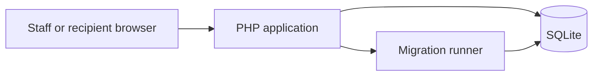

# Docwright

Docwright is a small document publishing application built with PHP and SQLite. Staff can create documents, schedule when they become available, search by title, and share a document through a generated link. The included records are synthetic examples.

## Features

- Versioned, transactional SQLite schema migrations.
- Staff sign-in with password hashing and session-based authentication.
- CSRF checks for document creation and share creation, plus basic security headers.
- Scheduled availability, literal title-prefix search, and readable share identifiers with 128 random bits.
- An audit log for document and share activity.
- In-memory checks and an HTTP smoke test using an isolated synthetic database.

## Architecture



The application uses PHP 8.3, PDO SQLite, SQLite, and standard browser technologies. The HTTP smoke test uses Python 3 and its standard library. No Composer packages are required.

## Configuration

The application reads process environment variables. The [.env.example](.env.example) file documents their names; it is not loaded automatically.

| Variable | Purpose |
| --- | --- |
| `DOCWRIGHT_DB_PATH` | Optional SQLite file path. If unset, the application uses `db.sqlite` in the project directory. |
| `DOCWRIGHT_DEMO_PASSWORD` | A locally chosen value required when creating the initial synthetic staff record. |
| `DOCWRIGHT_PHP` | Optional PHP executable path for the HTTP smoke test; defaults to `php`. |
| `DOCWRIGHT_TEST_BASE` | Optional parent directory for the HTTP test's temporary database. |

## Run locally

1. Install PHP 8.3 with `pdo_sqlite` enabled. Set `DOCWRIGHT_DEMO_PASSWORD` in your shell to a unique local value. Optionally set `DOCWRIGHT_DB_PATH` to the desired new database path.
2. From the project directory, initialize the synthetic data and start the server:

   ```sh
   php seed.php
   php -S 127.0.0.1:8000 -t public
   ```

3. Open `http://127.0.0.1:8000/` and sign in as `editor@example.test`, using the local value you set above.

The seed script refuses to overwrite an existing database. Choose a new database path to initialize another instance. The application uses the `America/Chicago` time zone for scheduled availability.

## Tests

```sh
php tests/test.php
python tests/http_test.py
```

The PHP checks use an in-memory SQLite database. The HTTP test initializes a new synthetic database, starts a local PHP server, and exercises sign-in, CSRF rejection, creation, literal search, sharing, scheduled availability, security headers, sign-out, and session replay prevention. It creates a scratch directory under `DOCWRIGHT_TEST_BASE` when that variable is set, or the system temporary directory otherwise. It does not delete that directory automatically.

The commands above were rehearsed with PHP 8.3 and Python 3. The Docker image and service were also built and exercised using a temporary Compose configuration with an isolated data mount and a dynamically assigned loopback port.

## Project structure

```text
lib/             Application helpers, layout, and migration runner
migrations/      Versioned SQLite schema changes
public/          HTTP routes and styles
schema.sql       Base schema
seed.php         Fresh synthetic data initialization
tests/           In-memory checks and HTTP smoke test
```

This is a development prototype. Share links are bearer links: anyone holding a valid link can view an available document. The app renders relative links; use your browser to copy a link with its current origin. Before a real deployment, add the access controls, transport security, operational configuration, and review appropriate to its use.
